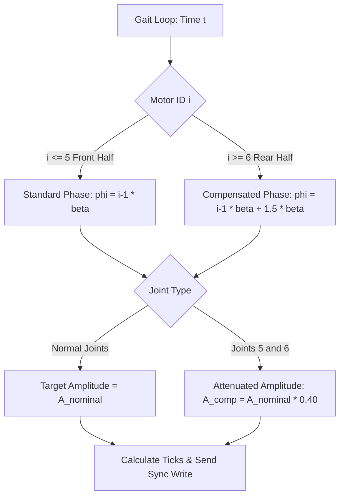

# Battery Middle Segment: Mechanical Dimensions, Kinematic Analysis & Firmware Compensation

## 1. Executive Summary & Structural Purpose

In the **SURGE-SNAKE** 10-motor architecture, the transition between **Servo 5** (Yaw joint) and **Servo 6** (Pitch joint) represents the geometric and dynamic midpoint ($L/2$) of the robot. 

To house an untethered high-discharge battery (e.g., $2\text{S } 7.4\text{V } 2200\text{ mAh}$ LiPo) without mounting deadweight at the head or tail, the standard alternating link connector ([alternate_connector.STEP](file:///c:/Users/bansi/OneDrive/Desktop/Snake_SURGE/3d_parts/3D_motion_parts/alternate_connector.STEP)) is replaced by the extended mid-body bay ([battery_middle.STEP](file:///c:/Users/bansi/OneDrive/Desktop/Snake_SURGE/3d_parts/3D_motion_parts/battery_middle.STEP)).

This document details:
1. Dimensional specifications of both CAD models extracted from STEP geometry.
2. The mathematical derivation of the resulting spatial wave distortion.
3. Torque and dynamic load impacts on Servos 5 and 6.
4. Firmware compensation algorithms for [snake_locomotion.py](file:///c:/Users/bansi/OneDrive/Desktop/Snake_SURGE/src/snake_locomotion.py) and [test_3d_snake.py](file:///c:/Users/bansi/OneDrive/Desktop/Snake_SURGE/test_3d_snake.py).

---

## 2. Comprehensive CAD Dimensional Analysis

Both components serve as alternating Pitch-Yaw U-brackets connecting two orthogonal ST3215 serial bus servos. The child servo's body mounts inside the cradle, with its rotation axis oriented at $90^\circ$ relative to the parent servo's horn axis.

```
       [Parent Servo Horn]                    [Child Servo Cradle]
        (Axis along X)                        (Axis along Y)
               |                                     |
               v                                     v
       +---------------+-----------------------+---------------+
       | Pivot 1 (Horn)|   Battery Bay Compart | Pivot 2 (Body)|
       +---------------+-----------------------+---------------+
       |<----------- Nominal Length L0 (alternate_connector) -------->|
       |<------------------ Extended Length L_5-6 (battery_middle) ------------------>|
```

### 2.1 Dimensional Comparison Table

| Parameter / Feature | Standard Connector (`alternate_connector.STEP`) | Battery Mid-Segment (`battery_middle.STEP`) | Delta ($\Delta$) | Engineering Significance |
| :--- | :--- | :--- | :--- | :--- |
| **Total Bounding Length ($Z$)** | $120.500\text{ mm}$ ($-40.0$ to $+80.5$) | $210.500\text{ mm}$ ($-40.0$ to $+170.5$) | **$+90.000\text{ mm}$** | Longitudinal extension along robot axis |
| **Bounding Width ($X$)** | $62.000\text{ mm}$ ($-31.0$ to $+31.0$) | $62.000\text{ mm}$ ($-31.0$ to $+31.0$) | $0.000\text{ mm}$ | Preserves lateral profile & body envelope |
| **Bounding Height ($Y$)** | $40.000\text{ mm}$ ($-22.0$ to $+18.0$) | $40.000\text{ mm}$ ($-22.0$ to $+18.0$) | $0.000\text{ mm}$ | Preserves ground clearance & profile height |
| **Pivot 1 Horn Center** | $(-31.000, 0.000, -30.000)\text{ mm}$ | $(-31.000, 0.000, -30.000)\text{ mm}$ | $0.000\text{ mm}$ | Identical parent servo mating axis |
| **Horn Pilot Bore ($\varnothing$)** | $\varnothing 6.000\text{ mm}$ ($R = 3.000$) | $\varnothing 6.000\text{ mm}$ ($R = 3.000$) | $0.000\text{ mm}$ | Standard ST3215 brass splined horn hub |
| **Horn Bolt Circle (PCD)** | $\varnothing 14.000\text{ mm}$ ($R = 7.000$) | $\varnothing 14.000\text{ mm}$ ($R = 7.000$) | $0.000\text{ mm}$ | 4-hole cross pattern for M3 fasteners |
| **Horn Screw Holes ($4\times$)** | $\varnothing 3.250\text{ mm}$ ($R = 1.625$) | $\varnothing 3.250\text{ mm}$ ($R = 1.625$) | $0.000\text{ mm}$ | Clearance holes for M3 mounting screws |
| **Child Servo Mount ($Z_1$)** | $Z = 17.500\text{ mm}$ | $Z = 107.500\text{ mm}$ | **$+90.000\text{ mm}$** | Primary mounting screw plane offset |
| **Child Servo Mount ($Z_2$)** | $Z = 41.500\text{ mm}$ | $Z = 131.500\text{ mm}$ | **$+90.000\text{ mm}$** | Secondary mounting screw plane offset |
| **Child Mount Hole Spacing** | $\Delta X = 22.000\text{ mm}$ ($\pm 11.0$) | $\Delta X = 22.000\text{ mm}$ ($\pm 11.0$) | $0.000\text{ mm}$ | Matches ST3215 servo ear bolt pattern |
| **Child Mount Pilot Holes** | $\varnothing 1.250\text{ mm}$ ($R = 0.625$) | $\varnothing 1.250\text{ mm}$ ($R = 0.625$) | $0.000\text{ mm}$ | M2 / M2.5 direct thread/tapping holes |
| **Nominal Inter-Joint Span ($L$)**| $\mathbf{60.000\text{ mm}}$ | $\mathbf{150.000\text{ mm}}$ | **$+90.000\text{ mm}$** | **$2.50\times$ inter-axis lever arm increase** |

### 2.2 Battery Cavity Internal Geometry (`battery_middle.STEP`)

The 90 mm extension forms a hollow internal compartment between the parent horn bearing boss and the child servo cradle:

* **Internal Longitudinal Length ($Z$):** $90.00\text{ mm}$ ($Z = 3.00\text{ mm}$ to $Z = 93.00\text{ mm}$)
* **Internal Transverse Width ($X$):** $36.00\text{ mm}$ ($X = -18.00\text{ mm}$ to $+18.00\text{ mm}$), expandable to $42.00\text{ mm}$ at side cutouts
* **Internal Vertical Depth ($Y$):** $32.00\text{ mm}$ ($Y = -16.00\text{ mm}$ to $+16.00\text{ mm}$)
* **Compatible Battery Form Factor:** Standard $2\text{S } 7.4\text{V } 1500\text{–}2200\text{ mAh}$ LiPo packs (typical dimensions: $85\text{–}100\text{ mm} \times 30\text{–}34\text{ mm} \times 14\text{–}18\text{ mm}$)

---

## 3. Mathematical Analysis & Kinematic Derivations

### 3.1 Continuous Serpenoid Curve Formulation

In snake robotics (Hirose Serpenoid curve), forward locomotion via lateral undulation is achieved by commanding joint angles to track a continuous spatial curvature $\kappa(s)$ along the arc length $s$:

$$\kappa(s) = -\alpha \frac{2\pi}{\lambda} \sin\left(\frac{2\pi s}{\lambda} - \omega t\right)$$

Where:
* $s \in [0, L_{\text{total}}]$: Arc-length distance from the snake head.
* $\lambda$: Spatial wavelength of the serpentine wave ($m$).
* $\omega = 2\pi f$: Temporal frequency ($\text{rad/s}$).
* $\alpha$: Wave angle amplitude ($\text{rad}$).

### 3.2 Discrete Joint Angle Approximation

For a robot composed of rigid links of uniform length $L_0$, the discrete relative angle at joint $i$ is obtained by integrating curvature over link $i$:

$$\theta_i(t) = \int_{(i-1)L_0}^{i L_0} \kappa(s) \, ds = 2 \alpha \sin\left(\frac{\pi L_0}{\lambda}\right) \sin\left(\omega t - (i - 1)\beta\right)$$

Where the **nominal spatial phase shift per joint** is:

$$\beta = \frac{2\pi L_0}{\lambda}$$

### 3.3 Spatial Disruption Induced by $L_{5\text{-}6} = L_0 + \Delta L$

When the link between Joint 5 and Joint 6 is replaced by `battery_middle.STEP`:
* $L_0 = 60.0\text{ mm} = 0.060\text{ m}$
* $\Delta L = 90.0\text{ mm} = 0.090\text{ m}$
* $L_{5\text{-}6} = 150.0\text{ mm} = 0.150\text{ m}$

The arc length coordinate $s_i$ for each joint becomes:

$$s_i = \begin{cases} (i - 1) L_0 & \text{for } 1 \le i \le 5 \\ (i - 1) L_0 + \Delta L & \text{for } 6 \le i \le 10 \end{cases}$$

#### Evaluation of Uncompensated Phase Error

If the software continues to increment phase uniformly by $(i-1)\beta$:
* **Actual required spatial phase at Joint 6:**
  $$\phi_{\text{actual}}(6) = \frac{2\pi s_6}{\lambda} = \frac{2\pi (5 L_0 + \Delta L)}{\lambda} = 5\beta + \frac{2\pi \Delta L}{\lambda}$$
* **Firmware commanded phase at Joint 6:**
  $$\phi_{\text{firmware}}(6) = 5\beta$$
* **Phase Rupture ($\Delta \phi$):**
  $$\Delta \phi = \frac{2\pi \Delta L}{\lambda} = \frac{\Delta L}{L_0} \cdot \beta = \frac{90.0\text{ mm}}{60.0\text{ mm}} \cdot \beta = 1.50 \cdot \beta$$

In [test_3d_snake.py](file:///c:/Users/bansi/OneDrive/Desktop/Snake_SURGE/test_3d_snake.py#L55), the configured phase offset is $\beta = \frac{\pi}{2} \approx 1.5708\text{ rad}$:

$$\Delta \phi = 1.50 \times 1.5708\text{ rad} = 2.3562\text{ rad} \approx 135.0^\circ$$

> [!CAUTION]
> A phase discrepancy of $135^\circ$ causes the rear half of the snake (Servos 6–10) to operate out-of-phase with the front half (Servos 1–5). The rear segments actively push against the forward momentum of the front segments, resulting in severe body buckling, high ground scrubbing, and complete loss of forward propulsion.

---

## 4. Mechanical Dynamics, Torque Margins & Load Calculations

### 4.1 Static Torque Capacity vs. Battery Mass (Overheating & Stall Verification)

A standard $2\text{S } 2200\text{ mAh}$ LiPo battery weighs approximately $130\text{g} - 150\text{g}$ ($m_{\text{battery}} \approx 0.15\text{ kg}$). 

The ST3215 serial bus servo provides:
* **Stall Torque ($\tau_{\text{stall}}$):** $19.5\text{ kg}\cdot\text{cm}$ ($1.91\text{ N}\cdot\text{m}$) at $5.0\text{V}$, and $24.0\text{ kg}\cdot\text{cm}$ ($2.35\text{ N}\cdot\text{m}$) at $6.0\text{V}$
* **Rated Continuous Torque ($\tau_{\text{cont}}$):** $\approx 0.50\text{–}0.70\text{ N}\cdot\text{m}$ ($5.0\text{–}7.0\text{ kg}\cdot\text{cm}$)

#### Worst-Case Static Cantilever Torque (Air Lift)
If the snake is picked up or articulates in free air with the battery centered along the $150\text{ mm}$ link ($r_{\text{cg}} \approx 75\text{ mm} = 0.075\text{ m}$):

$$\tau_{\text{static}} = m_{\text{battery}} \cdot g \cdot r_{\text{cg}} = 0.15\text{ kg} \times 9.81\text{ m/s}^2 \times 0.075\text{ m} \approx 0.110\text{ N}\cdot\text{m} \approx 1.12\text{ kg}\cdot\text{cm}$$

$$\text{Static Utilization Ratio} = \frac{\tau_{\text{static}}}{\tau_{\text{stall}}} = \frac{0.110\text{ N}\cdot\text{m}}{1.91\text{ N}\cdot\text{m}} \approx \mathbf{5.8\% \text{ of stall torque}}$$

Even if the entire rear half of the snake ($5\times$ links $\approx 0.50\text{ kg}$) is lifted in a full horizontal cantilever from Joint 5:

$$\tau_{\text{cantilever, max}} \approx 0.50\text{ kg} \times 9.81\text{ m/s}^2 \times 0.150\text{ m} \approx 0.736\text{ N}\cdot\text{m} \approx 7.5\text{ kg}\cdot\text{cm} \quad (\approx 38\% \text{ of stall})$$

#### Planar Ground Locomotion Support
During 2D serpentine crawling:
1. **Vertical Normal Support:** The floor carries $100\%$ of the gravitational weight ($F_N = mg$). The servo output shafts experience zero direct static bending load from gravity.
2. **Sliding Friction Resistance:** With kinetic friction $\mu \approx 0.30$:
   $$F_{\text{friction}} = \mu \cdot F_N = 0.30 \times (0.15\text{ kg} \times 9.81\text{ m/s}^2) \approx 0.44\text{ N}$$
   $$\tau_{\text{friction}} = F_{\text{friction}} \cdot r_{\text{cg}} = 0.44\text{ N} \times 0.075\text{ m} \approx 0.033\text{ N}\cdot\text{m} \approx 0.34\text{ kg}\cdot\text{cm} \quad (\mathbf{< 1.8\% \text{ of stall}})$$

> [!NOTE]
> **Conclusion on Stall & Overheating:** 
> The ST3215 is substantially over-specified for the physical mass of the battery. The battery weight ($150\text{g}$) represents a minor load ($<6\%$ static capacity). The servos **will not stall and will not overheat from the battery's weight alone**.

---

### 4.2 Why Amplitude & Wave Compensation Are Still Necessary

Because raw torque is not the limiting factor, kinematic compensation is required for **geometric envelope preservation** and **locomotion efficiency**:

1. **Spatial Wave Envelope Consistency:**
   Joint angular rotation $\theta$ creates lateral tip displacement:
   $$y_{\text{tip}} = L \cdot \sin(\theta)$$
   If the $150\text{ mm}$ link rotates at the standard angle ($A = 0.8\text{ rad} \approx 45^\circ$), its tip displaces $106\text{ mm}$ laterally compared to $42\text{ mm}$ for a $60\text{ mm}$ link. This creates a large bulge in the snake's body, forcing the tail to push sideways (pure drag) instead of channeling thrust along the progression vector. Attenuating the angle ($A_5 = 0.40 A$) ensures the long link stays inside the true serpenoid curve boundary.

2. **3D Pitch Ground Digging (Pole-Vault Effect):**
   In 3D mode, Joint 6 (Pitch) lifts the segment vertically. With $L = 150\text{ mm}$, vertical displacement is:
   $$\Delta y = 150\text{ mm} \cdot \sin(\theta_{\text{pitch}})$$
   At $\theta_p = 25^\circ$, the stroke is $63.4\text{ mm}$ (compared to $25.4\text{ mm}$ for $L = 60\text{ mm}$). Because the body chassis is only $40\text{ mm}$ high, this acts as a rigid lever ("pole-vault"), driving the battery housing into the ground and lifting adjacent segments 4 and 7 completely off the floor, which breaks anisotropic friction contact. Attenuating Joint 6 ($A_6 = 0.40 A$) prevents ground gouging.

3. **Dynamic Reversals & Gearbox Backlash:**
   Rotational inertia scales quadratically with link length:
   $$I = m L^2 \implies \frac{I_{5\text{-}6}}{I_{\text{nominal}}} \approx \left(\frac{0.23}{0.10}\right) \times \left(\frac{150}{60}\right)^2 = 2.3 \times 6.25 \approx 14.4\times$$
   Attenuating the angular acceleration of Joint 5 and 6 eliminates violent directional whip and gear backlash shocks when the traveling wave cycles back and forth.

---

## 5. Firmware Compensation Architecture

To restore a continuous serpenoid wave envelope and protect Servos 5 and 6, three compensations must be implemented in the gait generator.



### 5.1 Downstream Phase Shift Compensation

Advance the phase of all rear joints ($i \ge 6$) by $\Delta \phi = 1.50 \cdot \beta$:

$$\phi_i = \begin{cases} (i - 1)\beta & \text{for } 1 \le i \le 5 \\ (i - 1)\beta + 1.50\beta & \text{for } 6 \le i \le 10 \end{cases}$$

### 5.2 Curvature Amplitude Attenuation

To keep the spatial arc displacement continuous across the rigid section, scale the angular amplitude inversely with link length:

$$A_5 = A_{\text{yaw}} \cdot \left(\frac{L_0}{L_{5\text{-}6}}\right) = A_{\text{yaw}} \cdot \left(\frac{60.0}{150.0}\right) = 0.40 \cdot A_{\text{yaw}}$$

$$A_6 = A_{\text{pitch}} \cdot \left(\frac{L_0}{L_{5\text{-}6}}\right) = A_{\text{pitch}} \cdot \left(\frac{60.0}{150.0}\right) = 0.40 \cdot A_{\text{pitch}}$$

---

## 6. Production Code Implementations

### 6.1 Patch for `src/snake_locomotion.py`

Replace the naive `calculate_positions` function with the link-compensated formulation:

```python
import math

class SnakeKinematics:
    """Calculates motor target angles using an asymmetric serpenoid curve."""
    def __init__(self, num_motors=10, center_pos=2048):
        self.num_motors = num_motors
        self.center_pos = center_pos
        self.amplitude = 0.8
        self.frequency = 2.0
        self.phase_shift = 1.0  # beta
        self.turn_offset = 0.0
        self.ticks_per_radian = 4096.0 / (2.0 * math.pi)
        
        # Geometry Parameters
        self.L_standard = 60.0
        self.L_battery = 150.0
        self.phase_lag_comp = ((self.L_battery / self.L_standard) - 1.0) * self.phase_shift  # 1.5 * beta
        self.scale_factor_mid = self.L_standard / self.L_battery  # 0.40

    def calculate_positions(self, current_time, turn_offset=None):
        positions = {}
        angles = {}
        if turn_offset is not None:
            self.turn_offset = turn_offset

        for i in range(self.num_motors):
            motor_id = i + 1
            
            # 1. Spatial Phase Calculation
            spatial_phase = i * self.phase_shift
            if motor_id >= 6:
                spatial_phase += self.phase_lag_comp
                
            # 2. Amplitude Attenuation for Bridge Joints
            amp = self.amplitude
            if motor_id in (5, 6):
                amp = self.amplitude * self.scale_factor_mid

            target_angle = (amp * math.sin(self.frequency * current_time - spatial_phase)) + self.turn_offset
            ticks = self.center_pos + int(target_angle * self.ticks_per_radian)
            
            positions[motor_id] = max(0, min(4095, ticks))
            angles[motor_id] = target_angle

        return positions, angles
```

### 6.2 Patch for `test_3d_snake.py`

Update the 3D loop to prevent pitch pole-vaulting and maintain 3D wave continuity:

```python
# --- 3D TEST PARAMETERS (COMPENSATED FOR BATTERY_MIDDLE) ---
amplitude_yaw = 900
amplitude_pitch = 700
frequency = 0.6
phase_offset = 1.57  # pi / 2
extra_phase_rear = 1.50 * phase_offset  # 2.355 rad compensation

for i in range(1, 11):
    is_yaw = (i % 2 != 0)
    segment_index = (i - 1) // 2
    direction_mult = 1 if segment_index % 2 == 0 else -1

    # Apply spatial phase compensation downstream of the battery bay
    phase = segment_index * phase_offset
    if i >= 6:
        phase += extra_phase_rear

    # Scale down amplitude for motors 5 and 6 (longer lever arm)
    curr_amp_yaw = amplitude_yaw * 0.40 if i == 5 else amplitude_yaw
    curr_amp_pitch = amplitude_pitch * 0.40 if i == 6 else amplitude_pitch

    if is_yaw:
        sine_val = math.sin(2 * math.pi * frequency * t - phase)
        pos = 2048 + int(curr_amp_yaw * sine_val * direction_mult)
    else:
        sine_val = math.sin(2 * math.pi * frequency * t - phase - (math.pi / 2))
        pos = 2048 + int(curr_amp_pitch * sine_val * direction_mult)

    positions[i] = max(0, min(4095, pos))
```

---

## 7. Hardware Wiring & Electrical Safety Checklist

1. **Service Cable Length:** The X3P daisy-chain cable bridging between Servo 5 and Servo 6 across the 90 mm extension must be **at least 180 mm** (e.g., standard Robot Cable-X3P 180mm). A 100mm cable will bind and tear out under maximum joint rotation.
2. **Current Telemetry Warning:** Monitor the `Present_Current` or `Present_Load` via the serial bus driver. If Servo 5 or 6 load consistently exceeds $450$ ($45\%$), decrease the scaling factor from $0.40$ to $0.30$.
3. **Ground Friction Plane:** Ensure the underside of `battery_middle.STEP` sits at least $3\text{ mm}$ above the bottom contact tangent plane of the snake belly to ensure the TPU/rubber anisotropic friction pads engage first.
